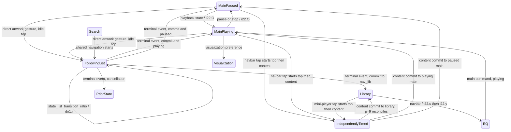

# Poweramp 1031 — scene and animation engine

This is a static reconstruction of the supplied binary, not an observed animation recording. All paths below are relative to the private decoded/decompiled workspace. Exact identifiers are preserved, including the non-ASCII package `ׅ` and Cyrillic method names. `CONFIRMED_STATIC` means the stated branch/condition is established; it does not mean the owner's installed configuration or a frame duration was observed.

## The central finding: independently controlled motion systems

The player/library boundary uses at least three controllers:

1. **Top scene controls:** `TopNavSceneFastLayout.v = i22`; inherited `SceneFastLayout.u = do1`. This controls the waveform/transport group, sub-art buttons, status/navigation backgrounds and other top-level scene participants. Source: `jadx/sources/com/maxmpz/audioplayer/widget/TopNavSceneFastLayout.java:24–29`; `.../widget/base/SceneFastLayout.java:19–20,79–82`.
2. **Artwork/list content:** `ListWidget` inherits `om0` and `PowerList`; `PowerList.K = x32` owns transitions, `PowerList.B = vj0` owns two layout/data slots, and `w32` advances transition progress. The full artwork/title item is part of this list system. It is not an image child interpolated solely by the top `do1` scene.
3. **Mini-player/navbar:** `navbar_container` is another **private** `SceneFastLayout`; `NavbarExtension.t1` drives this private `do1`, although the mini-player itself is the separate `navbar_list` sibling inside `Navbar`. Its clock is not the full-player waveform clock. Source: `decoded/res/layout-sw2dp/merge_navbar.xml:4–37`; `jadx/sources/ׅ/gx0.java:422–518`; `.../player/NavbarExtension.java:216–244`.

This architecture explains why using one declared 250/350/500ms value for the entire experience cannot be authoritative. Foreground bitmap replacement and the native backdrop have additional animation paths; see report 06.

## State identifiers and owners

`i22.p` is an internal navigation/playback state. These numbers are not Android resource IDs.

| Internal `p` | Meaning established from transitions | Top scene |
|---|---|---|
| `-2`, `-1` | Startup/uninitialized variants | Initialization dependent |
| `0` | Main player, not playing | `0`, which `do1.о` resolves to `_tag_scene_zero` |
| `1` | Main player, playing with normal UI | `scene_playing` |
| `2` | Visualization-only | `scene_vis` |
| `3` | Visualization plus faded UI | `scene_vis_w_ui` |
| `4` | Temporary full UI over visualization | `scene_vis_temp_ui` |
| `5` | Library | `scene_lib` |
| `6` | EQ | `scene_eq` |
| `7` | Search | `scene_search` |
| `8` | Top scene follows list transition progress | Source and prepared target retained in `do1` |
| `9` | List transition without top progress following | Terminal event reconciles final scene |
| `10` | Lyrics navigation | Navigation maps to `scene_lib`; separate lyrics scene resources also exist |

Sources: `i22.у(IIZZ)` at Java 1755 and smali 11323; `i22.О(IZZ)` at Java 1447; `i22.onBusMsg` at smali 6750–7880. `p=8/9` labels above are descriptive names for validated behavior, not recovered original names.

`do1.B` is a different state variable: `0` idle, `1` prepared/interpolating, `2` temporary setup/finalization. `do1.X` changes to the requested target during preparation, before the visual interpolation has completed; `do1.x` retains the previous scene. Do not read `X` as “the scene currently painted in full.” Source: `do1.p`, especially smali 6622 onward, and `do1.d`.



The diagram distinguishes direct gesture following from programmatic tap navigation. The canonical tap routes below establish `p=9`; search/lyrics branches and modal/navigation gates add further conditions.

## Entry points and control flow

### Programmatic navbar navigation

`merge_navbar` supplies `FastButton` IDs `cmd_nav_to_lib`, `cmd_nav_to_eq`, `cmd_nav_to_search`, and `cmd_nav_more`. The click receiver `gx0` calls `u1`, which changes activated button states and sends the corresponding command on the GUI bus. The list/page manager owns library/search navigation and emits `nav_lib`/`nav_search`; EQ/main commands can enter `i22` directly. Do not collapse command IDs and state notification IDs.

`i22.onBusMsg` gates navigation using `g()`, activity state and the nonanimated bit `0x10000000`. Deferred command slots are `D/E/F`; when `state_list_nav_allowed` becomes 1 they are posted and cleared. `i22.с` dispatches the accepted command; `i22.у` maps library/EQ/search/lyrics to a top scene; `i22.O` selects and starts a timed top transition only when its target differs from `do1.X`. Sources: `gx0.java:125–135,422–518`; `i22.java:1060–1130,1627–1776`; corresponding `i22.smali:onBusMsg` labels `:cond_68` onward and `с(III)`/`у(IIZZ)`.

EQ additionally calls `cmd_list_force_ab_on_screen` before scene selection; changing EQ tab while already in state 6 updates `c40.o` and emits `nav_eq` without rerunning the same screen transition (`i22.с`). The back handler `i22.r0` works only for EQ while navigation is permitted, returning to library when `c40.о` is enabled, otherwise main.

### List/content navigation, including artwork drag

Verified chain:

```text
page selection or gesture-produced transition type
  -> x32.X(type, optional instance, provider bundle, positions, flags)
  -> transition.В(...) prepares current/next layout engines and shared item
  -> om0.E(...) emits state_list_transition(target navigation ID, flags)
  -> i22.onBusMsg: idle top can prepare p=8; already-timed tap path selects p=9

finger-driven progress OR w32 animation frame
  -> vj0.О(raw ratio)
  -> vj0.p(clamped ratio)
  -> outgoing layout.t(ratio,false), incoming layout.t(1-ratio,true)
  -> layout/render updates
  -> om0.Q() emits state_list_transition_ratio(Float.floatToRawIntBits(B.х))
  -> i22.onBusMsg, only p=8: do1.r(ratio,false,0,0)

settle completion/cancellation
  -> w32.А -> x32.А
  -> swap/retain layout/data slots, cleanup transition ownership
  -> ListWidget.K0 posts state_list_transition(-1, terminal flags)
  -> i22 settles or restores do1, resolves final navigation/playback state
```

Sources: `om0.java:171–189,262–269`; `vj0.java:521–538,741–778`; `x32.java:95–143,150–214,345–426`; `ListWidget.java:99–116`; `i22.smali:6750–7880`. The heavily malformed Java reconstruction of `i22.onBusMsg` was cross-checked against smali for target scene selection and completion/cancellation.

Message flag meaning is recoverable from the producers: bit 1 is the originating interaction flag passed through the transition; bit 2 indicates animation-enabled/start or animated completion; bit 4 on the terminal event means commit. On start, `om0.E` stores the target navigation ID in `S` and invalidates that state before dispatch. On finish, `ListWidget.K0` sets `S=-1` before posting the terminal message.

### Normal preparation versus an already-running top scene

When the list starts an animated navigation:

- `i22` stores target navigation in `О` and previous internal state in `O`.
- If the top helper is idle, it sets `p=8`, calls `do1.р(targetScene,false)`, and waits for list ratios. Target `nav_main` selects `scene_playing` if current playing state is 1, otherwise scene 0. `nav_lib`/`nav_lyrics` select `scene_lib`; search selects `scene_search`.
- If a top transition is already active, there are **special completion branches**: for navigation to a list-like destination while the prior state and current target agree on main paused/playing/temporary-visualization, `do1.b(false,false)` finishes the existing target first, then the receiver can prepare the new following transition.
- Other already-active combinations set `p=9`; top control geometry then does **not** follow ratio messages. The terminal event reconciles it.
- With animation flag clear, the receiver also uses `p=9`, without setting up a progress-following top scene.
- Terminal commit in `p=8` calls `do1.b(false,false)`; terminal cancellation calls `do1.b(false,true)` and restores the prior internal navigation state. `p=9` skips this direct follower-finalization but still reconciles navigation.

This is narrower and more precise than “all gestures smoothly reverse an animation.” Source: `decoded/smali/ׅ/i22.smali:onBusMsg`, source lines 6750–7880, especially labels `:cond_3c`, `:cond_45`, `:cond_4d`–`:cond_66`. JADX reversed a `nav_main` comparison and dropped joins in this region; use the smali as the authoritative branch map.

## Canonical settled player ↔ All Songs, including mini-player tap

This bounded route is resolved more deeply than the complete category/search matrix. Conditions: populated, settled and visible main player; main `С` page and All Songs file page are ready (`sd.Q()` means `x` is 3 or 4); no other pending transition; navigation permitted; animations enabled; visualization not overriding the normal main scene. The All Songs provider is `sf1 = mg1.getFiles()` (`sf1.F0` returns `R.string.all_songs`, `g` returns `files`). `library_home` defaults to 0 (`b40.I0`); `gi1` entry 0 invokes `ei1` case 0 → `getFiles()`. A remembered/deliberately requested other URI can override this destination. `p31` maps `files` to factory 15 and, because `sf1.j0()` is the root `mg1` equal to its `d()`, constructs `f32 → b32 → g32 → af → pd`; `pd.R()` is false, while main `С.R()` is true. Reusing an existing page additionally requires `sd.T`: ready or loading, equal entity/provider and equal encoded URI path.

### Item correspondence is a concrete predicate, not simply “same cover”

`p31.В(source,target,positions)` first requires **both pages ready**. With one main `С` and one All Songs page:

- Compatibility `С.y0(other)` requires a nonnull player-track snapshot `С.C`. The All Songs page is a `g32` whose entity is `tf1`, so it is compatible if the main entity does not implement `bi1`, or if the main entity's `q(otherEntity)` reports equality. A normal `sf1` entity does not implement `bi1`. This does not require every compatible ordinary file page to be the identical provider.
- **Player → All Songs:** `p31.A` takes main index `P.q`, obtains the stable track ID through `С.x() → Р.х(index)`, and asks the target `n0(trackID, mainIndex, mainPage, false)`. Success is any result other than −1; passed transition indices become `[mainIndex, matchedLibraryIndex]`. Failure sets both −1.
- **All Songs → player:** `p31.В` requires nonzero main stable ID, takes the hint from the main URI `pos` or falls back to current library `D()`, and asks library `n0(trackID, hint, mainPage, true)`. Passed indices become `[matchedLibraryIndex, mainIndex]`; failure sets both −1.
- For the ordinary file-page path, inherited `yc.n0` rejects IDs 0 and −2; a matching precomputed loader result (`em0.Х && em0.H==ID`) returns its position. Otherwise `xc.В → l2.g/f` searches the cursor's ID column. The outward `false` permits full-cursor fallback; inward `true` restricts fallback search. With `EXTRA_IDS_TO_POS_MAP`, inward matching rejects an ID outside the engine's valid `[B.B(),B.А()]` interval. Without that map, current-cursor and hinted-position fast matches return before range restriction; therefore **“offscreen current track always forces pivot” is not established**. Exact branches are in `l2.smali:2824–3306`; this helper was checked in smali because Java loses its joins.

### Selected content transition and timing

| Route / correspondence | Effective class selected by `p31.Z` | Base content time before helper |
|---|---|---:|
| Main `С` → ordinary All Songs, match true | `PowerListSharedItemTransition` | `hl0.V / pageAnimTime` = 250ms |
| Main `С` → ordinary All Songs, match false | `PowerListForwardGenericPivotTransition` | same 250ms |
| Ordinary All Songs → main `С`, match true | `PowerListSharedItemTransition` | same 250ms |
| Ordinary All Songs → main `С`, match false, previous nav not EQ | `PowerListForwardGenericPivotTransition` | `hl0.d0 / topLibToAAAnimTime` = 250ms |
| Same unmatched return with `state_prev_nav=nav_eq` | `PowerListForwardGenericPivotTransition` | `hl0.b0 / libSearchAnimTime` = 150ms |

`ListWidget.s0` does not replace these two classes; its replacements apply only to specific swipe-header classes. These selections require `p31.C` animation permission. If `state_gui_nav_is_probably_list` is false, the selected content time is zero. This state is false during EQ navigation; its resolver uses previous nav for the first 16ms after navigation changes. `AnimTimeHelper.calcAnimTime(time,true)` is then applied; `x32.X` must successfully prepare the transition, and `x32.A(true,animate,false,time)` settles it. This is a programmatic commit using the `w32` timed branch, not the manual 500dp/s release decision.

### The tap route deliberately has independent clocks

**Library-navbar tap:** `cmd_nav_to_lib → p31.a/B → Z` first calls `p31.f(target,animate)`; that sends `nav_lib` **before** `x32.X`. The real bus `bw0.В` dispatches subscribers immediately, unlike `post`. `i22.с → у → O` therefore starts the top scene timer and changes internal state to 5 before `om0.E` emits the list-transition start. At that start `do1.B` is active and previous internal state is 5, which selects `p=9`. Top controls ignore list ratio notifications and keep their independent timer.

**Mini-player tap back:** `Navbar.onItemClick` requires a nonnegative valid mini item, then calls `gx0.u1(cmd_nav_to_main,0,true,false,false,null)` when navigation is allowed (it can first close its sheet and retry the permission state). `i22.с → О → O` starts the top main-enter timer **before** `O.j` synchronously broadcasts `nav_main`. That triggers `p31.C → С/B → Z`, then the content start sees an already-active top transition targeting main; it also selects `p=9`. This tap does not promote the navbar's mini artwork view into the full artwork item.

For this canonical, already-initialized route, stock nominal clocks are therefore **outward: top 250ms, content 250ms, private navbar 500ms; inward: top 500ms, content 250ms, private navbar 500ms**. Their easing differs, and the first qualifying top transition may add 350ms; helper settings also apply as described below. These are source-selected clocks, not measured wall times. In contrast, the direct artwork gesture can start list progress while the top helper is idle and use `p=8` following. A single “main/library duration” would lose this distinction.

### Shared geometry specific to this route

The shared transition locates both item holders after preparing the two engines and positioning the target to the matched index (`u31.B`). When exactly one engine is `P` and the other is a list `mj0`, and both holders exist, `PowerListSharedItemTransition.Х` configures the **list engine** with:

```text
r = artworkItemLayout.height / libraryRowLayout.height
pivotX = listEngine.А(libraryRowLayout, libraryRowIndex)
pivotY = rowCenterY + (rowCenterY - artworkCenterY) / r
listEngine.c(pivotX, pivotY, r)
```

`h0.c` stores mode 4 and these parameters. For a single-column list, `h0.А` returns the row's **left edge**; grid columns can choose outer edge or center. At per-item fraction `f`, `h0.j` uses scale `1 + (r-1)*f` multiplied by the engine's base scale; it shifts each item's top-left by `(itemCenter-pivot)*(scale-1)` with float-to-int truncation, and `h0.w` assigns alpha `1-f` (the engine receives complementary fractions for incoming versus outgoing items). This is an item-dependent pivot calculation, not a generic center-scale zoom. Holder-copy/swap/hide additionally requires `vj0.x==2`, both holders and equal item types; its cleanup restores visibility. The exact item view scenes/metrics still depend on report 03's resolved geometry, and painted continuity remains unobserved.

Sources for this bounded route: `jadx/sources/ׅ/b40.java:288`; `gi1.java:9`; `ei1.java:23–25`; `sf1.java:12,20–31,116–129`; `p31.java:131–133,150–247,254–423,1011–1044,1273–1320`; `sd.java:137–150`; `pd.java:341–343`; `С.java:184–195,291–335`; `yc.java:19–30`; `xc.java:274–280`; `decoded/smali/ׅ/p31.smali:A/В at830–1240, Z at3697–5270 (notably :cond_15/:cond_16/:cond_1a/:cond_21/:goto_6/:goto_9/:goto_f)`; `decoded/smali/ׅ/С.smali:y0 at2220–2341`; `decoded/smali/ׅ/l2.smali:f at2824–3306`; `decoded/smali/ׅ/bw0.smali:В at1407–1526`; `decoded/smali/com/maxmpz/audioplayer/widget/Navbar.smali:onItemClick at1249–1484`; `decoded/smali/com/maxmpz/audioplayer/list/ListWidget.smali:s0 at3184–3271`; `i22.java:159–215,617–634,1627–1776` plus `i22.smali:onBusMsg :cond_4d–:cond_56`; `decoded/smali/com/maxmpz/widget/list/PowerListSharedItemTransition.smali:245–1307,1309–1478`; `h0.java:247–252,950–1010,1183–1198` and `h0.smali:4011–4242`; `decoded/res/values/styles.xml:11269–11274`.

## Effective timing and interpolation

### Top scene, when independently timed

The following stock `TopContainer` declarations map to constructor fields through `wa1.N0` (Java line 111). The scene entry code actually selects them as follows:

| Condition in `i22.O` | Selected field / declaration | Stock nominal duration | `AnimTimeHelper` applied here? |
|---|---|---:|---|
| Scene 0 ↔ any `yz1.y` playing/visualization scene | `m` / `playStateAnimTime` | 320ms | No, this branch passes raw duration |
| Normal player scene ↔ visualization variants | `s` / `visAnimTime` | 320ms | No, raw duration |
| Target navigation is main | `n` / `animMainEnterTime` | 500ms | Yes |
| Leaving main to non-EQ destination | `q` / `animMainExitTime` | 250ms | Yes |
| Other scene changes, including main→EQ | `k` / `animTime` | 150ms | Yes |
| Forced animation requested when otherwise zero | `l` / `forcedAnimTime` | 250ms | Yes |

`i22.H()` requires laid-out and window-visible before ordinary animation. A static process-wide `i22.T` adds **0.35 seconds once**, on the first qualifying animated `O` transition; it is added **after** preference duration adjustment. It is not a delay before drawing. Playback/visualization branch precedence can override the simple navigation cases above. These numbers do not apply to every list-following path.

Sources: `decoded/res/values/styles.xml:7387–7413`; `jadx/sources/ׅ/i22.java:79–125,159–213`; `decoded/smali/ׅ/i22.smali:810–1218`, labels `:cond_4`, `:cond_9`–`:cond_d`, `:goto_5`. Smali confirms the scaled duration is retained on the main/general branches; the malformed Java variable flow must not be read as overwriting every value.

`do1.X` prepares and starts `do1.у`. That settling helper computes:

- `speed = clamp(argument, 0, 10)`.
- `baseSeconds = argument > 0 ? argument : 1`.
- `nominalMs = trunc(1000 * abs(1 / (1/baseSeconds + speed)) + 0.5)`.
- `ao1` stores the current `do1.A` progress and endpoint 1 (commit) or 0 (reverse), then animates a local 0→1 fraction with **Android `DecelerateInterpolator(2.0)`**.
- `ao1.P` maps eased local fraction between saved progress and endpoint, then calls `do1.r`.

The direct `do1.X` path passes speed 0, so its nominal duration equals the selected duration; it does not multiply duration by the remaining progress distance. This differs from `w32` list settling. Sources: `do1.java:748–765,1819–1854`; `decoded/smali/ׅ/do1.smali:11152–11401`; `ao1.java:29–44`.

### Frame driver and early completion

`h5` uses `Choreographer.postFrameCallback`. Frame timestamp nanoseconds are converted to integer milliseconds. The first callback establishes its start time. `h5.В` computes elapsed/duration in **double arithmetic**, applies the interpolator, and either paints or completes. The decompiler printed `j2/j3` in Java without the casts; smali explicitly uses `long-to-double` and `div-double` (`h5.smali:476–482`).

Both `ao1` and `w32` configure tolerance `1e-4`; `h5` can finish when the interpolated local fraction exceeds `1 - 1e-4`, before nominal elapsed duration. For the Android factor-2 decelerator, `e(u)=1-(1-u)^4`, this condition is analytically `u>0.9`. That is a mathematical consequence, not a runtime measurement. Frame quantization and first-callback timing remain unobserved. On completion, `h5.Н` first clears its running bit 4, then calls `P(finalValue)` if the endpoint-paint flag 2 is set, then `А(direction)` for completion and finally `Р()` for cleanup. Endpoint painting and completion callbacks therefore observe the timer as no longer running. This order matters for callbacks that start another animation. Cancellation via `h5.B` removes the frame callback and runs cleanup without forcing the endpoint or completion callback.

Sources: `h5.java:20–25,43–47,66–105,158–177`; `decoded/smali/ׅ/h5.smali:402–601,610–706,1145 onward`; `ao1` constructor setup is in `do1.у`.

### List transition settling — actual duration calculation

`x32.х(commit, animate, ..., durationSeconds, normalizedVelocity)` stops its previous `w32` first. If animation is false, it immediately runs `x32.А` to commit/cancel the content slots.

For an animated non-velocity settle, `w32.р -> h5.Х` uses:

| Settle | Distance scaling when current progress is interior | Minimum scaled time |
|---|---|---:|
| Commit to 1 | `round((1-progress) * nominalMs)` | 100ms |
| Cancel to 0 | `round(progress * nominalMs)` | `floor(nominalMs/3)` |

At exact full range 0→1 or 1→0 the helper keeps nominal duration. The interpolator is Android `AccelerateDecelerateInterpolator` for both initial and user-release slots in this binary (`x32.K` and `x32.К` initialized to the same instance); mathematically `(1-cos(pi*u))/2`. Early-completion tolerance still applies.

If retained normalized velocity is positive for a commit, it is clamped to `[1/durationSeconds, 8]`; if negative for a cancellation it is clamped to `[-8,-3.5]`. `w32.p` then selects its velocity mode when direction/progress/time guards pass. `w32.В` advances `progress=start + velocity*elapsedSeconds`; the acceleration term is literally 0 in the DEX, not an inferred physical spring. It completes above approximately .9999 or below .0001, or on NaN. This path does not wait for the nominal time once the endpoint is reached.

Sources: `x32.java:345–426`; `decoded/smali/ׅ/x32.smali:1947–2468`; `w32.java:28–117`; `decoded/smali/ׅ/w32.smali:420–698`; `h5.smali:715–1020`. Android mathematical formulas are explanatory equivalents of named framework interpolators; no browser curve was selected.

### Release decision that feeds the list settle

For transitions inheriting `PowerListTransitionBase.A`, smali establishes:

- Divide supplied signed velocity by display density.
- If magnitude is at least **500dp/s**, commit iff its sign agrees with `vj0.y` (positive ≥500 for forward, negative ≤−500 for reverse).
- Otherwise commit iff progress is **strictly greater than .3**.
- Reverse direction negates the normalized-velocity argument on the fast-velocity branch.
- **Zero the velocity passed to `x32`** when committing at progress >.8, or cancelling at progress <.2. Else retain it.
- Commit uses `PowerList.a()`; cancel uses `PowerList.с()`. `om0.a()` returns `hl0.W` (`pageManualCommitAnimTime`, constructor default 250ms); `om0.с()` returns `hl0.Y` (`pageManualCancelAnimTime`, default 500ms). No override of either attribute was found in decoded `values*/styles.xml`. These generic release defaults are distinct from artwork-local 550/650ms motion; do not substitute `aaPosSettleAnimTime`.

The velocity-zeroing condition in the decompiled Java is reversed. This report uses the smali branches `:goto_3` (zero) versus `:cond_5` (retain). Sources: `decoded/smali/com/maxmpz/widget/list/PowerListTransitionBase.smali:32–248`; `om0.java:277–279,1242–1244`; `hl0.java:165–167`; `wa1.java:66`. See report 05 for touch ownership and the artwork-local scroll/settle engine, which is a separate `w`/`ch0` path.

### Content timing resource selection

`ListSubstyleBase2` supplies page 250ms, artwork-position 550ms, artwork-position-settle 650ms, library↔search 150ms, artwork→top library 250ms, top library→artwork 250ms, artwork→search 150ms, search→artwork 250ms, artwork→lyrics 250ms, lyrics→artwork 150ms. `hl0` reads these into different fields; `p31.Z` selects by current/target page type, shared-track correspondence, previous nav and `state_gui_nav_is_probably_list`, then applies `AnimTimeHelper.calcAnimTime(duration,true)` before `x32.A`.

This path was traced through the actual call into `x32`, with pivotal selection branches checked in `p31.smali:4000–4490`. It does **not** establish that every library opening takes 250ms: item correspondence, provider replacement, the chosen shared/pivot/fade transition, page readiness and gesture-driven duration remain inputs. The canonical main↔All Songs tap routes above are resolved. The complete combinatorial `p31.Z` dispatch table for other category/search combinations remains **OPEN**. The smallest next trace is `p31.Z(sd)` smali lines 3697–5270, correlating `sd.R()`, `С`, `bk0`, `vo1`, `fp0` and the boolean returned by `p31.В`.

### Animation preference

`c40` creates `anim_speed` with default **1** (`c40.java:184–188`). Both helper overloads choose the effective value with the exact expression `(ul1.В(dj0.В, 2) < 1 && ul1.В(dj0.В, 1) != 4) ? c40.n0.B : c40.n0.А`. `qg0.B` is the immutable constructor-supplied default, while `qg0.А` is the current value, optionally loaded from the mapped settings buffer and later changed by `у(int)`. The helper can therefore use default 1 even when a different value is stored. The meaning of the protected buffer fields is unresolved; the branch itself is established. For nonzero duration:

| Effective mode | Integer helper | Float helper, `allowDisable=true` | Float helper, `allowDisable=false` |
|---|---|---|---|
| 0 | 1ms | .001s | duration ×.6 |
| 2 | rounded duration ×.6 | duration ×.6 | duration ×.6 |
| Other, including default 1 | unchanged | unchanged | unchanged |

Zero remains zero. The owner's effective mode and gate state are unknown. This is app preference logic; the examined custom `h5` frame driver has no Android animator-duration-scale lookup. That does not prove all unrelated app animations ignore system accessibility settings.

Source: `jadx/sources/com/maxmpz/widget/player/AnimTimeHelper.java:22–58`, paired smali; `jadx/sources/ׅ/qg0.java:10–23,46–50` identifies `B` as default and `А` as stored/current value.

## Navbar/mini-player private timeline

`gx0.u1` responds to nav state, marks buttons active, toggles mini visibility `w`, and chooses seek line `c0`. `c40.j0` is `navbar_seekbar`, default true (`c40.java:179`); lyrics can force that line. It calls `NavbarExtension.t1(sheetOpen, miniVisible, seekLine, immediate)`.

| Requested state | Private navbar scene | Nominal stock clock |
|---|---|---:|
| Full player, sheet closed | scene 0 | `twoLineExitAnimTime` 500ms |
| Other page, mini visible, seek disabled | `scene_navbar_2lines` | `twoLineEnterAnimTime` 500ms |
| Other page, mini visible, seek enabled | `scene_navbar_3lines` | same 500ms |
| Menu sheet open | corresponding 1/2/3-line `_sheet` scene | separate `um` animation params |

`NavbarExtension.t1` calls `calcAnimTime(f,false)`, so effective preference 0 still produces .6× duration in this path. Explicit `immediate` or detached-view branches call `do1.f` instead of starting animation. The private scene reuses `do1` easing/interruption machinery. This is confirmed in `NavbarExtension.smali:1009–1177`; declarations are `styles.xml:6242–6256`. Runtime captures must establish the observable phasing against the content and top scene.

## Per-element motion and composition

| Element | Rendering/layout owner | During main↔library | Established versus missing |
|---|---|---|---|
| Full album artwork, title, subtitle, rating | AA item in `ListWidget`/`P` engine | Shared-item or pivot/fade content transition; current and next layout slots receive complementary ratios | Item reuse and shared-item branch exist; exact matrix depends on source/target item and geometry. See UI atlas for endpoints. |
| Waveform/transport/time labels | Top `do1`, nested `waveseek_layout` | `TopWaveseekLayout_scene_lib` goes GONE with scale .75; engine interpolates visible alpha/scale and applies final visibility | Not the mini-player transport. Per-frame endpoints depend on active style and child recalculation. |
| Sub-art controls | Top `do1` | Scene-specific style and visibility; same top progress when follower mode | Exact setting-dependent scene values in UI atlas. |
| Navbar container | Private `do1`, then outer top-scene visibility/alpha | Independent one-line to mini-player 2/3-line preparation/timer; outer container remains visible for main/lib/search/EQ | Distinct clocks and scene ownership confirmed. |
| Mini artwork/title/play button | Separate `navbar_list` and `item_miniplayer` | Created/updated as navigation enables mini-player | No evidence that the full artwork becomes this same view instance. |
| Background artwork | `ol0` coordinating `MilkWidget/MilkRenderer`, renderer/native slots | Updated/ratio-driven through dedicated rendering path, not merely an alpha on root background | See report 06; native rendering/frame output unobserved. |
| Seek pressed/seeking feedback | State animation `ex1` overlay in `do1.y` | Independent state animation can multiply scene alpha via `do1.i` | Prevent flattening state alpha into a single hardcoded scene alpha. |

`do1.r` interpolates each bounds edge with `Math.round(start + delta*p)`. It separately interpolates flagged alpha and uniform XY scale; supports dynamic remeasure, one-time measure switching, layout-only or translation optimization; invokes custom `tn1.V0` where flagged. Elevation can be set at preparation rather than continuously interpolated. Visibility is finalized at target/cancel. Sources: `do1.java:624–733,1379–1498`; `do1.smali:r(FZIF)` line 8336 onward; scene declarations in `activity_main.xml` and styles. Labels can also receive custom scene callbacks via `FastTextView`/`MarqueeFastTextView`; not every intermediate label metric is resolved here.

Shared-item preparation inspects source/target stable item positions and may copy/swap holders and hide one duplicate view while the shared item is represented once. `PowerListSharedItemTransition.f0` restores visibility and clears held references. Move-up/down variant offsets the paired engine by half an artwork-engine height; horizontal forward/reverse variants also offset by ±list width (`PowerListSharedItemTransition.java:267–304`, `u31.A` calls each layout engine's `с`). Exact item matrices remain endpoint-dependent; this is not evidence for a generic center-scale zoom.

## Interruption, cancellation, resize and reentrancy

| Situation | Source-established behavior | Limits |
|---|---|---|
| Retarget a running top `do1` transition | `p` tests existing state, invokes old listeners, cancels `ao1`, captures source view bounds including translations, and prepares new target; assigns `X` before interpolation; reentrancy guard `d` rejects nested preparation | Caller-specific branches can force endpoint completion first. No universal “preserve every painted pixel” claim. |
| Reverse prepared top transition | `do1.у(false,...)` starts from current `A` toward 0; `b(...,true)` restores source bounds/layout/alpha/scale and resets `X` to prior `x` | List-following code usually supplies ratios and terminal event instead of this timer. |
| Start list navigation during top playback transition | Special matching main-state cases finish top target, then follow list; other combinations use `p=9` | Detailed source state table above; runtime regrab must test both. |
| New `x32` transition while one active | Generally refused; exception permits `AASmallTransition.Х` handling; not every in-flight transition is replaceable | Input controller's regrab path is separate; see report 05. |
| List settle restarted | `x32.х` cancels existing `w32`, reads current `vj0.х`, and starts new end-directed settle | Current progress retained for this call; target-provider replacement can follow a different path. |
| Request layout during top transition | `SceneFastLayout.requestLayout` records `do1.g` while `B` is 1/2 or state animation active; `onLayout` can defer normal layout; completion requests deferred layout | Rotation/inset update output not captured. |
| List size changed | `PowerList.onSizeChanged` marks layout dirty; `onLayout` recalculates current or both active engines | Exact mid-frame rotation result needs original runtime. |
| Permanent list detachment | `PowerList.p` cancels input, active transition and providers; temporary-detach flag avoids this cleanup | Top layout's own detach hook alone does not explicitly cancel `h5`; window lifecycle interaction remains unverified. |
| Scene state mutation versus touch | Target state is written before final paint; navigation permission and active transition flags affect new requests | Prevents treating geometry and state as one atomic CSS class switch. Touch-target ownership is in report 05. |

Sources: `do1.smali:p` line 6622 onward; `do1.O` snapshots view translation in source bounds; `do1.b/d`; `x32.java:35–73,95–147,345–426`; `SceneFastLayout.java:60–76`; `PowerList.java:1024–1040,1110–1158,1171–1217`.

## Track change is not the main/library scene transition

`p31.onBusMsg(msg_player_track_changed)` calls `Н(track, ..., true,true)`. That method chooses between updating the existing main page, replacing/rebinding it, or deferring while another page is pending/not active. Existing-page `С.t0` updates track metadata and current-list state. If page state `x` is 1 or 2 it assigns the artwork engine position `P.q` directly. Otherwise it permits animation only when its input animation flag is true and `z22.х()` returns reason 1, 2, 3 or 4. `D0` then selects animated `ListWidget.Z(index)` only when `b40.E` (`aa_anim`, default true) and that permitted flag are both true; otherwise it calls immediate `A(index)`. When the artwork engine is not initialized or this page is not active, `D0` stores `P.q` instead of moving the visible list. Artwork-horizontal motion is the `w`/`ch0` engine described in report 05; the 550/650ms declarations feed that engine through `С.р`, rather than the top `i22` controller.

Navbar independently receives the same track message: `Navbar.y1` can update the mini list in place or use a forward generic pivot transition with **.35 seconds** when the provider/change reason requires a new page; it defers while hidden/inactive/pending. Sources: `p31.java:1139–1141,2028–2090`; `С.java:94–108,247–285,384–386`; `b40.java:235`; `Navbar.java:216–226,405–450`. The mini-player replacement-pivot branch specifically requires a changed nonzero prior provider ID and reason 3, 4 or 5; it is separate from the main artwork reason 1–4 gate.

Bitmap availability and art-derived background completion are asynchronous. The precise foreground/background synchronization across rapid successive tracks is **OPEN** at `p31.Н -> С.t0/D0`, the `w` frame callbacks, and `ol0`/`MilkRenderer` slot update sequence. Report 06 establishes rendering calls; an original-build recording with two visually distinct covers is the smallest runtime test.

## Reproduction boundaries and next evidence

Confirmed static: canonical main↔All Songs tap selection, correspondence predicates, shared pivot and distinct tap/gesture ownership; multiple motion owners; actual command/progress/terminal chain; state mutation order; top timer selection and first-animation addition; app speed helper; named easing; custom frame driver; distance/velocity settling; release thresholds and decompiler corrections; independent mini-player scene; shared-item ownership and resize/deferred-layout mechanisms.

The source mutation order at the main boundaries **is established**: `do1.p` changes target before painting, `h5.Н` clears running before final paint/callback, `om0.E` stores the target before posting start, and `ListWidget.K0` clears its target before posting terminal. These facts should not be listed as a general unknown. The remaining static work is narrower:

| Static gap | Exact unresolved methods / boundary | Smallest next source trace |
|---|---|---|
| Complete content transition selection | `ׅ.p31.Z(sd)`, `p31.В(sd,...)` shared-item correspondence, current/target `sd.R()` classifications | Canonical main↔All Songs is resolved above. Enumerate remaining branches in `decoded/smali/ׅ/p31.smali:3697–5270` with `bk0` / `vo1` / `fp0`, recording transition class and `hl0` time field. |
| Every source/target shared-item matrix and label rule | `PowerListSharedItemTransition.В`, its move/pivot subclass hooks, `u31.A`, layout-engine `с`, and custom `tn1.H0/V0` callbacks reached by `do1.O/r` | Start with one known current-track row and main `С` item; follow stable-item correspondence and the exact two engines used, then resolve the selected custom callback rather than extrapolating one generic zoom. Endpoint geometry is in report 03. |
| Generic navigation regrab and page-ready race | `PowerList.d0`, `x32.X`, `AASmallTransition.Х`, `km0` cancellation/ownership plus gesture adapter `w.О` | Follow a second DOWN into the adapter while `x32.х` is true, inspect which active transitions allow the special existing-transition path, and determine whether `km0.А/Х` finishes or cancels before ownership changes. AA-local regrab is established separately: `j0.K(DOWN) → w.f → w.x` removes the frame callback without zeroing model offset, and `a0.у` snapshots the selected index; the next `w.C` continues from that offset. The smaller remaining AA-local trace is `u.run` frame cases 0/1 → model `Р` against `w.x` callback removal. See report 05. |
| Exact top-scene response to inset/size change during an active preparation | `TopNavSceneFastLayout.onApplyWindowInsets -> i22.X(WindowInsets)`, inherited `FastLayout.onMeasure`, and `SceneFastLayout.onLayout` | Compare one inset change at idle and at `do1.B=1`, track whether target/source `zn1` scene bounds are recomputed or retained until deferred layout. List dirty-marking and active-engine relayout are already confirmed. |
| Activity/background lifecycle of a top timer | `TopNavSceneFastLayout.onDetachedFromWindow`, the no-op helper access in `SceneFastLayout.onDetachedFromWindow`, and `i22.onBusMsg` activity/window notifications | Follow unregister/cleanup and timer cancellation calls; the detach hook alone is insufficient to assert full-frame cancellation. Permanent `PowerList` detach cleanup is confirmed. |
| Rapid track/provider replacement and backdrop synchronization | `p31.Н -> p31.С / С.t0/D0`, deferred handler `L`, `Navbar.y1/w1`, and `ol0` foreground/background update callbacks | Enumerate an existing-page update versus provider replacement while one replacement is pending; record order of slot creation, queued handlers, `w` position change, art request, ratio update and commit. Report 06 already resolves the renderer/native API endpoints; remaining work is coordinator ordering, not unknown native API identity. |
| Remaining navigation/visualization combinations | `i22.onBusMsg`, `i22.О`, `i22.у`, navigation-permission `g()` | Restrict to one concrete unresolved input combination at a time (e.g. visualization showing when a list transition starts), trace the source state and resulting `p=8/9`, rather than infer from declared scene names. |

Each row is a code-level gap that can be reduced without a runtime. A source trace can establish state and callback order; only original-build execution can establish rendered continuity, latency and the actual owner's configuration.

Blocked runtime evidence: gesture-to-painted-frame latency, real system animation-scale behavior across all controllers, current density/insets, relative main/list/navbar phasing, redraw artifacts during reversal, and final label/art matrices under the owner's settings. No frame duration or seamless reversal was observed in this session.

Minimal next capture: fixed viewport and unchanged built-in settings, start with animations normal, record one tap-open and tap-close, one partial drag cancelled, one partial drag committed, then regrab each midway. Include paused and playing states and a first transition after cold app start. Capture frame timestamps if using ADB screen recording, and record refresh rate/font scale/density. Do not use a browser recreation as the reference.
