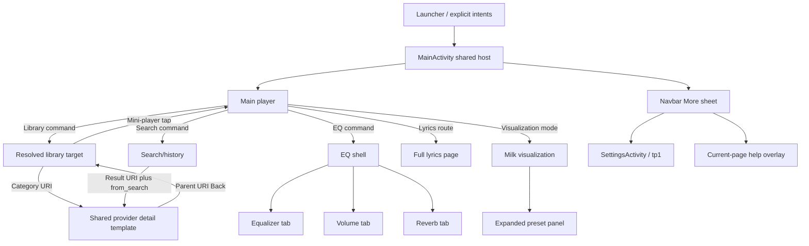

# Poweramp 1031 — Session 2 screen atlas and navigation reference

This is a static reference to the supplied APK. It separates a rendered page from a data-dependent page template, embedded component, overlay, external Android surface, and a nonvisual entry activity. **It is not a claim of 144 independent screens or complete runtime coverage.** No native Android instance was run, and no player implementation was changed.

The machine-readable companions are `screen-registry.json`, `navigation-graph.json`, and `evidence-ledger.jsonl`. Each entry has native identifiers, construction owner, entrypoints, settings dependencies, backing resources/components, back policy, evidence, depth, and exact gaps. `layout_resource_variants` lists available resource qualifiers; it does not assert which variant an unknown device selected. The effective-style/layout report resolves configuration-sensitive values.

## Coverage denominator

| Source denominator | Count | What the count means |
|---|---:|---|
| Manifest activity classes | 40 | All declared activities, including three nonvisual intent bridges and four SDK activities. |
| Manifest aliases | 23 | Fifteen launcher icons, four legacy main-UI aliases, one USB alias, one Settings alias, and two distinct dialog-content aliases. |
| Library catalog variants | 20 | All `gi1` entries and their `ei1` suppliers, not only enabled/default rows. |
| Library routing keys | 16 | Fifteen nonempty keys plus the empty home key in `p31`; separate main factory selector adds one. |
| Settings XML/helper factory pages | 45 | `tp1.onCreate` helper dispatch proved by smali; not a guarantee that every page/control is visible on every platform/edition. |
| Typed atlas entries | 144 | Includes templates, modes, SDK candidates and nonvisual components. |
| Directed typed graph edges | 196 | Includes command/intent routes, declared preference links, factory dispatch, conditional entry, back and render-state edges. |
| Screen evidence records | 146 | Claim-level static records; graph edges additionally carry direct source citations. |

The first five source denominators are complete for their stated registries. The list of all possible confirmations, failures, provider instances, external permission dialogs, SDK purchase states and cross-products of settings is **not** exhausted. The common dialog/popup mechanisms are represented without promoting every string/resource into a proven reachable screen.

## Top-level ownership and routes

`MainActivity.onCreate` inflates `activity_main` (`jadx/sources/com/maxmpz/audioplayer/MainActivity.java:74–86`). Main player, library, search, lyrics, equalizer and visualization share this activity. `TopNavSceneFastLayout/i22` governs top scenes; `ListWidget/p31` resolves library/main/lyrics/search content; the private navbar controller governs mini-player/More-sheet state. They are not independent Android activities.

`behavior_eq_layout`, `behavior_search_layout` and `vis_panel_loadable_beahvior` supply `loadForScene` and `android:layout`, with `unload=never`. `LoadableBehavior.A/B` performs actual insertion on a matching scene (`styles.xml:13273–13295`; `LoadableBehavior.java:111–158`). This proves construction beyond merely finding matching XML names.

The diagram is an orientation aid; the JSON graph carries guards and source owners. A symbolic family source node means “any applicable page”, not an additional renderer.

`i22.P(Intent)` processes explicit actions for Main, EQ (`eqTab`), Library/data URI, Show Current and Search/query. Legacy `EqActivity`, `PlayListActivity` and `PlayerUIActivity` aliases select the corresponding mode only in the component fallback branch after action processing. This fallback is smali-checked (`decoded/smali/ׅ/i22.smali:2170–2375`). The `ListActivity` alias is registered to MainActivity; no distinct branch for it was found in that fallback. USBMainActivity is disabled in the manifest. State restoration separately uses `pa_page`, `eq_tab`, `lib_uri`, `lib_pos` and `search` (`i22.Р`, Java 1530–1580); malformed/fallback restoration ordering still merits a targeted smali pass before implementing every recovery state.

### Important Session 1 qualification: fresh Library target

The registered `library_home` value is 0, but `prevbuild` registers −1 and `Application.с` migration for old build <810 writes `library_home=-1`. With no restored/reusable/explicit URI, `p31` finds no catalog item for −1 and opens the category chooser. Explicit 0 selects All Songs. A previous/reusable page can take precedence. Therefore Session 1's canonical player↔All Songs animation trace remains valid for that explicit destination; its registration-default wording must not be read as the effective fresh-install destination. Sources: `b40.java:288,340`, `Application.java:631–634`, `p31.java:1293–1316`, Session 2 PREF-009/010 and the screen ledger `library.default_migration` record.

## Library catalog and shared templates

`gi1` is the finite catalog denominator, `ei1.get` supplies the real provider, and `bk0.Н` filters it by the persisted `library_lists` bitmask. `bk0.P→yj0.o` uses **item_text** for category chooser rows (`bk0.java:31–37`, `yj0.java:20–22`). The category pages mostly use `item_track`, backed by the shared item renderer; grid/list appearance is model/style state, not another activity or a different album-screen XML.

`p31.a` resolves the URI with `mg1.y`, transforms the entity through `e0`, looks up `entity.n()`, then calls `p31.B`. The decisive allocation branches were cross-checked at `decoded/smali/ׅ/p31.smali:1856–2417`. `e4.K` reuses/inflates row views by item type; `e4.о` maps track/text/separator type IDs to concrete layouts (`e4.java:61–90,149–168`). Header/decor/empty rows are selected by `md.o` and page adapter configuration. In `kc` category lists, `ic.o` maps regular rows to the track template; root album lists use `r3.o`; flat folders use `i60.o`.

| Catalog bit | User-facing category | Provider | Router key | Page class | Evidence |
| 0 | All Songs | getFiles / sf1 | files | f32 | PA1031-S2-SCREEN-003 |
| 1 | Folders | getFolders / yf1 | folders | k60 | PA1031-S2-SCREEN-004 |
| 2 | Folders Hierarchy | getFoldersHier / cg1 | folders_hier | h60 | PA1031-S2-SCREEN-005 |
| 3 | Albums | getAlbums / se1 | albums | t3 | PA1031-S2-SCREEN-006 |
| 4 | Artists | getArtists / ze1 | artists | o9 | PA1031-S2-SCREEN-007 |
| 5 | Album Artists | getAlbumArtists / le1 | artists | o9 | PA1031-S2-SCREEN-008 |
| 6 | Albums by Artist | getAlbumsByArtist / ue1 | albums | t3 | PA1031-S2-SCREEN-009 |
| 7 | Genres | getGenres / eg1 | genres | o9 | PA1031-S2-SCREEN-010 |
| 8 | Composers | getComposers / hf1 | composers | o9 | PA1031-S2-SCREEN-011 |
| 9 | Playlists | getPlaylists / ri1 | playlists | d61 | PA1031-S2-SCREEN-012 |
| 10 | Queue | getQueue / ui1 | queue | ja1 | PA1031-S2-SCREEN-013 |
| 11 | Most Played | getMostPlayed / oi1 | played_files | tv0 | PA1031-S2-SCREEN-014 |
| 12 | Recently Played | getRecentlyPlayed / zi1 | played_files | xb1 | PA1031-S2-SCREEN-015 |
| 13 | Top Rated | getTopRated / sj1 | rated_files | bb1 | PA1031-S2-SCREEN-016 |
| 14 | Recently Added | getRecentlyAdded / yi1 | files | f32 | PA1031-S2-SCREEN-017 |
| 15 | Low Rated | getLowRated / ii1 | rated_files | bb1 | PA1031-S2-SCREEN-018 |
| 16 | Long Tracks | getLong / hi1 | files | f32 | PA1031-S2-SCREEN-019 |
| 17 | Years | getYears / vj1 | years | ub2 | PA1031-S2-SCREEN-020 |
| 18 | Streams | getStreamFiles / rj1 | files | f32 | PA1031-S2-SCREEN-021 |
| 19 | Bookmarks | getBookmarks / ef1 | bookmarks | gh | PA1031-S2-SCREEN-022 |

The following detail templates are actual dispatch branches, not a claim to have enumerated each artist/album/playlist/folder instance:

| Branch | Construction predicate | Owner |
| Albums inside an artist / category | albums entity is not th1 | p31.B→u3 |
| Album-style track detail | parent category q(entity.d()) is false and entity implements wg1 | p31.B→e32 |
| Category / playlist / folder track detail | parent category q(entity.d()) is false and entity is not wg1 | p31.B→c32 |
| Nested folder hierarchy | nested hierarchy URI resolves folders_hier | p31.B→h60 |
| Root file-provider list | parent category q(entity.d()) is true | p31.B→f32 |

Most Played and Recently Played share `played_files` but select different classes (`oi1→tv0`, `zi1→xb1`). Recently Added is `yi1` and follows the ordinary `files` branch. Album Artists reuse the `artists` key; Albums by Artist reuse `albums`. Top/Low Rated share `rated_files`. Streams and Long Tracks are filtered file-provider variants. These distinctions are based on provider construction, not label similarity.

### Back and navigation history

`sd.m` returns its stored override parent URI if present, otherwise computes/caches `entity.O(currentUri)` (`sd.java:294–303`). `p31.X(testOnly)` is smali-checked at 3346–3690. It consumes the event while a target is pending or the list is unavailable. With `start_at_lib=true` and Main current, execution tries the current-track category. Otherwise it opens a non-null parent URI. With no parent, lyrics first tries Main; then `start_at_lib=true` sends non-home pages to the category chooser and home returns false. With `start_at_lib=false`, a non-main page tries Main and Main returns false. A failed concrete route can return false. `X(true)` probes rather than executing normal route mutation.

This is provider/URI navigation and page cache reuse, not a literal browser push/pop stack for each visited screen. Top EQ has its own `i22.r0`: Library when `start_at_lib`, Main otherwise. Active popup/selection/help/More/dialog consumers participate before the underlying page according to registered Back dispatch; see the input report. The callback-registration mechanism and current active consumers must be reproduced together.

## Search, lyrics, equalizer and visualization

Search has a top control subtree (`merge_search_layout`) and `vo1` list page. Search-history row ID −3 calls `X0(query)` and returns no child URI. A history-row secondary action removes one item; the clear-history row clears all. Normal result rows build entity-specific URIs and preserve `from_search` when needed (`vo1.f/y`, Java 373–439 and 674–707). `jj1` supplies the multi-category result set (Java 438). Text changes have no debounce at the UI boundary traced by the input agent. Query result timing/content remain data/backend dependent.

Full lyrics is `fp0` inside the shared list and inflates `item_lyrics`. It is distinct from the `LyricsActivity` dialog. `merge_menu_items_aa` supplies tap `cmd_nav_to_lyrics_or_app` and long-press `cmd_data_lyrics`. `p31` checks `lyrics_in_menu`: value 1 invokes the data-command/dialog route; other values open the full page. Long press directly takes the legacy dialog route (`p31.java:1342–1355`, `c40.java:181`, `x8.java:140–149`). This is a settings-dependent navigation branch, not two interchangeable renderers.

EQ shell contains three simultaneously constructed tab subtrees—equalizer, volume and reverb—selected by `eq_tab` and `BusAAScrollingBehavior`. The equalizer's band provider computes `L = bands != null && (bands.length==0 || bands[0].х)`. Position zero is preamp; L selects `c10` parametric rows and an extra final controls row; non-L selects `f10` linear knob rows. These are dynamic components in one tab (`com/maxmpz/widget/player/В.java:145–153,188–200,304–312`). `MilkFRS` and `FrequencyResponseScroller` are separate spectrum/response rendering systems; consult the rendering report rather than deriving either from the scene animation clock.

The EQ menu is actually installed by `BusActionPopupLayout(menuItemsLayout=merge_eq_menu_layout)`, then `p61.F1` inflates it. Its actions include autosave, lock, save/assign, rename, share/export/import and restore. Preset popup selection, full `EqPresetsActivity`, assignment and save dialogs are separate surfaces linked in the graph.

Visualization has three top scene modes: full visualization, temporary UI and persistent overlaid UI. The actual `VisPanelFrame` adds preset list/filter/sort/advance controls, with a private expanded-panel scene. These coexist with the native Milk renderer. A preset picker is a conditional panel, not an additional main Activity. Rendering output depends on preset/native support and is not yet device-observed.

## Overlays and transient components

| Surface | Construction/entry | Evidence |
| Visualization preset picker / filter | VisPanelFrame binds PowerList preset cursor; scene_vispanel_expanded reveals filter/sort controls | PA1031-S2-SCREEN-035 |
| Navbar More sheet | gx0.v1 expands existing NavbarExtension; merge_navbar installs shim and menu items | PA1031-S2-SCREEN-036 |
| Mini-player | Navbar constructor/gx0 installs small PowerList; shared current-track binding | PA1031-S2-SCREEN-037 |
| Context menus for track/category/header | om0.l0 obtains page n(int[]) menu resource and detaches selected row into t61 popup; page class selects menu family | PA1031-S2-SCREEN-038 |
| Selection action mode | activity_main includes merge_selection_menu; page t() chooses action items; SelectionMenuBehavior controls visibility | PA1031-S2-SCREEN-039 |
| Contextual help overlays | i22 cmd_gui_open_help→sb0 dispatches current nav and EQ tab to help merge; custom layout help also allowed | PA1031-S2-SCREEN-040 |
| Sleep timer popup | cm2.Р dynamically builds xv1 and assigns merge_sleep_timer_popup_layout | PA1031-S2-SCREEN-041 |
| EQ preset popup | EQ tab resource constructs EqPresetPopupListLayout; shared PowerList/preset popup controller | PA1031-S2-SCREEN-042 |
| Reverb preset popup | EQ tab resource constructs ReverbPresetPopupListLayout; shared PowerList/preset popup controller | PA1031-S2-SCREEN-043 |
| DSP information popup | cm2.Р creates popup with merge_dsp_info_popup_layout | PA1031-S2-SCREEN-044 |
| Player button editor | SubAAButtonsLayout.F1 locates installed LoadableDraggableButtonsBehavior and loads merge_subaabuttons_edit | PA1031-S2-SCREEN-140 |
| Equalizer menu | merge_eq_equalizer_tab_common installs BusActionPopupLayout with menuItemsLayout; p61.F1 inflates merge_eq_menu_layout | PA1031-S2-SCREEN-141 |
| State-choice popup family | Installed menu/visualization controls construct BusSelectablePopupButtonLayout; inherited fp1 reads buttons labels/arguments and shared popup host | PA1031-S2-SCREEN-142 |
| List empty/loading/header/decor states | md.o maps -4 to configured empty layout, -5 and -2/-10 to configured header/decor; page adapter assigns empty/config templates | PA1031-S2-SCREEN-143 |
| Dialog loading/progress/toast states | Common dialog merge contains progress title, toast panel and content/button scene substitutions | PA1031-S2-SCREEN-144 |

Navbar More, generic popups, selection and dialog sheets have distinct lifecycle timing. For example, the More controller clears/unregisters its modal state immediately when requesting close; selection mode can wait on its own teardown. Navbar More and actual nested dialog scroll input were statically traced in Session 2 INPUT-031/032. Do not collapse these into a universal modal behavior.

The player button editor is reachable: `SubAAButtonsLayout.F1` checks mode/modal/entitlement gates, locates the installed LoadableDraggableButtonsBehavior, loads `merge_subaabuttons_edit`, and sets modal state. Settings `EditButtonsRedirPref` closes Settings, launches its Main intent, then posts begin-edit after 150ms or 500ms if theme changed. Long press adds its own movement/disable-setting gates. The layout exposes available buttons plus centered/two-line/small options.

By contrast, **merge_eqbuttons_edit is an unproven candidate**. Its resource/style exists, but no installed behavior_eqbuttons_edit reference was found in the stock EQ subtree; that subtree includes fixed `merge_eq_equalizer_buttons`. The shared editor's F1 checks `nav_main`. The registry explicitly excludes this resource-only candidate from confirmed reachable families. The next trace is custom inflater/cm2 construction or external skin insertion, not visual imitation of an unused XML file.

## Dialog and auxiliary activity construction

A lack of `R.layout` in a dialog subclass does not mean it has no renderer. `BasePowerWidgetActivity.В` derives `dialog_<actual Intent component short name>`, resolves a theme attribute, applies the component style, then the forced style. The Java decompilation reverses the nonzero-theme success check; smali at 2686–2695 confirms that nonzero applies styles. `BaseDialogActivity.onCreate:69–82` inflates `dialogLayout`; `layout-sw1dp/dialog.xml` then includes `?dialogContentLayout`, optional title extra and buttons, plus progress/toast scene states.

This makes `PlaylistShortcutActivity` and `MusicFoldersActivity` meaningful alias surfaces even though both target the empty `GenericDialogActivity` class. The actual Intent component name picks different content. The bare GenericDialogActivity host is not counted as a third themed screen. MusicFolders has actual entry routes from library menus, a library preference (`ss1` case0), and a conditional first MainActivity flow; PlaylistShortcut has the manifest CREATE_SHORTCUT entry.

| Dialog/activity surface | Content layout(s) | Route depth | Evidence |
| WelcomeActivity | dialog_content_welcome | renderer_proven_route_open / route OPEN | PA1031-S2-SCREEN-096 |
| InfoActivity | dialog_content_info | routed_and_constructed | PA1031-S2-SCREEN-097 |
| EditTagActivity | dialog_content_edit_tag | routed_and_constructed | PA1031-S2-SCREEN-098 |
| ExpiredActivity | dialog_content_scrollable_text | renderer_proven_route_open / route OPEN | PA1031-S2-SCREEN-099 |
| ChangelogActivity | dialog_content_scrollable_text_spread | routed_and_constructed | PA1031-S2-SCREEN-100 |
| EditNameActivity | dialog_content_text_input | routed_and_constructed | PA1031-S2-SCREEN-101 |
| SelectAlbumArtActivity | dialog_content_select_album_art | routed_and_constructed | PA1031-S2-SCREEN-102 |
| AutoFindDialogActivity | dialog_content_auto_find | routed_and_constructed | PA1031-S2-SCREEN-104 |
| SettingsLicenseActivity | dialog_content_webview | routed_and_constructed | PA1031-S2-SCREEN-105 |
| APMUnlockDialogActivity | dialog_content_apm_unlock | routed_and_constructed | PA1031-S2-SCREEN-106 |
| AudioBufferActivity | dialog_content_audio_buffer | routed_and_constructed | PA1031-S2-SCREEN-107 |
| EqPresetAssignActivity | dialog_content_eq_preset_assign | routed_and_constructed | PA1031-S2-SCREEN-108 |
| AddEqPresetActivity | dialog_content_add_eq_preset | routed_and_constructed | PA1031-S2-SCREEN-109 |
| AddReverbPresetActivity | dialog_content_add_reverb_preset | routed_and_constructed | PA1031-S2-SCREEN-110 |
| ListOptsActivity | dialog_content_list_opts | routed_and_constructed | PA1031-S2-SCREEN-111 |
| PlaylistSortActivity | dialog_content_resort | routed_and_constructed | PA1031-S2-SCREEN-112 |
| LyricsActivity | dialog_content_lyrics | routed_and_constructed | PA1031-S2-SCREEN-113 |
| MediaRouteChooserActivity | dialog_content_mediaroute_chooser | routed_and_constructed | PA1031-S2-SCREEN-114 |
| MediaRouteControllerActivity | dialog_content_mediaroute_controller | routed_and_constructed | PA1031-S2-SCREEN-115 |
| EqPresetsActivity | dialog_content_eq_presets | routed_and_constructed | PA1031-S2-SCREEN-116 |
| AlertDialogActivity | dialog_content_alert_dialog, dialog_content_alert_dialog_msg, dialog_content_alert_dialog_msg_w_padding | routed_and_constructed | PA1031-S2-SCREEN-117 |
| PlaylistSelectActivity | dialog_content_playlist_select, dialog_title_extra_playlist_select | routed_and_constructed | PA1031-S2-SCREEN-118 |
| AudioInfoActivity | dialog_content_audio_info | routed_and_constructed | PA1031-S2-SCREEN-119 |
| PlaylistsExportActivity | dialog_content_playlists_export | routed_and_constructed | PA1031-S2-SCREEN-120 |
| PlaylistShortcutActivity | dialog_content_playlist_shortcut | routed_and_constructed | PA1031-S2-SCREEN-128 |
| MusicFoldersActivity | dialog_content_music_folders | routed_and_constructed | PA1031-S2-SCREEN-129 |
| Save widget style name | widget_dialog_name | constructed_conditional_dialog | PA1031-S2-SCREEN-131 |
| Custom color picker | ambilwarna_layout | constructed_conditional_dialog | PA1031-S2-SCREEN-132 |

WelcomeActivity and ExpiredActivity have confirmed content/theme construction, but their installed upstream launch paths were not found. They are explicitly `renderer_proven_route_open`, not confirmed normal navigation destinations. APM unlock is reached by the Website purchase restore row in `already_purchased`; AudioBuffer is reached by `nr1/vq1` for `audio_output_device_opts`, with output/device/profile extras. Info/edit-tags/album-art/legacy lyrics data-command routes are explicit in `x8`; the selection Info route requires one valid selected item and closes selection before posting the command. `InfoActivity` can later route to Edit Tags or stream-name editing.

The generic PseudoAlertDialog/AlertDialogActivity mechanism is proved, including message, choice/list and custom content. It is reused for confirmations/errors/options; this inventory does not claim to enumerate every callsite or conditional error state. Four third-party SDK activities have internal SDK launch references, while the complete app edition/license/account-to-SDK guard matrix remains open.

## Settings and externally hosted UI

All 45 `tp1` XML/helper allocations are represented as `settings.<xmlname>`. Factory edges are typed `factory_route`, while XML `w:target` links are `declared_route`, so a factory's existence is not mistaken for a visible menu item. Settings controls, defaults, migrations and helper semantics are in the settings registry and settings-system report. The screen graph does not duplicate those controls or call action/status rows persistent values.

| Settings page | Helper |
| singlepane | qt1 |
| general | ns1 |
| already_purchased | yp1 |
| buy_methods | yp1 |
| feature_packages | ls1 |
| ui | yp1 |
| ui_theme | yp1 |
| ui_theme_opts | ur1 |
| ui_icon | vt1 |
| ui_player | yp1 |
| ui_lyrics | xp1 |
| ui_notify | yp1 |
| ui_mediaactions | xp1 |
| vis | vr1 |
| lockscreen | ht1 |
| aa_bg | xp1 |
| aa | wp1 |
| audio | yp1 |
| fade | yp1 |
| audio_focus | yp1 |
| audio_dvc | nq1 |
| audio_tweaks | yp1 |
| rg | yp1 |
| audio_resampler | yp1 |
| audio_equ | pq1 |
| peq_equ_bands | yp1 |
| peq_equ_tone | ur1 |
| audio_outputs2 | qr1 |
| audio_output_device_opts | nr1 |
| audio_outputs_tweaks | yp1 |
| audio_bit_perfect | gq1 |
| headset | qs1 |
| library | xs1 |
| library_lists | yp1 |
| library_search | yp1 |
| library_queue | yp1 |
| library_playlists | ct1 |
| library_shuffle | yp1 |
| library_scanner | yp1 |
| misc | nt1 |
| translations | yp1 |
| commands_history | ks1 |
| audio_platform_log | vr1 |
| support | st1 |
| space | yp1 |

Four widget configuration activities share `BaseWidgetConfigure`: it inflates `widget_conf` and the Background/Text/Buttons/Other pages, while subclasses supply widget geometry/style/provider. Back commits the widget style, like Done; see `widget-settings.md` and PA1031-S2-WIDGET-001..009 for the 37 conditional option IDs and update/store timing. The launcher-hosted widgets are a separate four-surface family. Provider `В.j` actually constructs RemoteViews; each subclass supplies root/art layout choices. Their application-open PendingIntent uses ACTION_OPEN_MAIN.

Poweramp lock-screen mode uses **the same MainActivity/activity_main**, not a separate lockscreen layout. PlayerServiceCore can send Intent `ls=true` while playing with the setting enabled. MainActivity delegates to `ln0`, which applies keyguard/audio-mode/time conditions, orientation policy and show-when-locked (`MainActivity.java:80–86`, `PlayerServiceCore.java:845–881`, `ln0.java:61–155`). OEM/background-activity restrictions remain runtime questions.

Notification construction has three implementation branches selected by `f11.В` from `rs2.X` and API: MediaStyle `py0`, decorated custom `qy0`, and custom `ny0`. Custom variants use status_controls/status_controls_big; the notification tap uses ACTION_SHOW_CURRENT or ACTION_OPEN_MAIN according to `b40.c1`. Framework/OEM templates are external rendering surfaces, not main-player pages. VoiceSearchHelperActivity, PowerampAPIActivity and RstrActivity are nonvisual intent bridges that finish; no independent visible UI is inferred from them.

## What still needs source work, and what needs execution

| Type | Exact gap | Smallest next trace |
|---|---|---|
| Source | All provider/detail action and parent combinations | Enumerate page `f/m/n/t/d0` overrides and entity `O/N/a/G0`, starting `kc.f`, `v3.f`, `c32/e32/h60` and `vo1.f`; retain provider class and URI predicates. |
| Source | All category-to-category animation choices | Extend `p31.Z` smali switch/class dispatch beyond the Session 1 canonical Main↔existing All Songs route; connect chosen classes to already traced x32 mechanisms. |
| Source | Restoration/error fallback exact ordering | Smali `i22.Р` (pa_page), `i22.P` initial-state fallbacks, and asynchronous `p31.B/Z` cache readiness/replacement ordering. |
| Source | Welcome/Expired application entry | Trace first-run/licensing state code and dynamic route strings/component construction feeding BaseStartupActivity/Application; class renderer is already established. |
| Source | SDK activity app-facing guards | Trace purchase/restore helpers into each SDK entry facade; internal activity intents alone do not prove a particular edition exposes the flow. |
| Source | Every transient confirmation/error/choice variant | Inventory PseudoAlertDialog builder callsites and confirmTitle/confirmText BusAction behavior; bind callers to current page/data/count guards. |
| Source | EQ button editor candidate | Look for custom inflater or skin-installed behavior_eqbuttons_edit; stock fixed EQ buttons and nav_main editor guard do not establish reachability. |
| Runtime | Exact scene composition and repaint/interrupt behavior | Install/run build 1031 with declared configuration profiles; record frame-by-frame navigation, reversal, resize and IME transitions. |
| Runtime | Data-dependent rows and content | Controlled fixtures for artist/album/playlist/folder/stream/bookmark/search/lyrics providers and empty/error states. |
| Runtime | External hosts | Widgets, notification/lockscreen, media route, SAF/permissions, billing/store and keyboard behavior on explicit API/OEM profiles. |

This inventory is ready to guide architecture, fixture design and further source tracing. It is **not yet an implementation-ready claim of faithful behavior for every configurable screen**. The source-only gaps above remain concrete investigation work; the runtime gaps require execution rather than more asset-name enumeration. Implementation should consume the effective style, input, rendering and settings contracts together with this route registry.

## Reproduction and validation

`session2/scripts/build_screen_registry.py` regenerates registry/graph/ledger from the decoded/JADX workspace and `session2/logs/settingssystem-helper-extraction.json`; `write_screen_atlas.py` regenerates this report. The scripts write only derived research artifacts. The original APK and decompiled source are not embedded into these artifacts.

Validation checks unique entry IDs, all graph endpoints, available layout files, and every evidence source path. Direct source pointers are provenance into the local decoded/JADX tree, not redistributed source. Counts are generated from the delivered JSON files.
